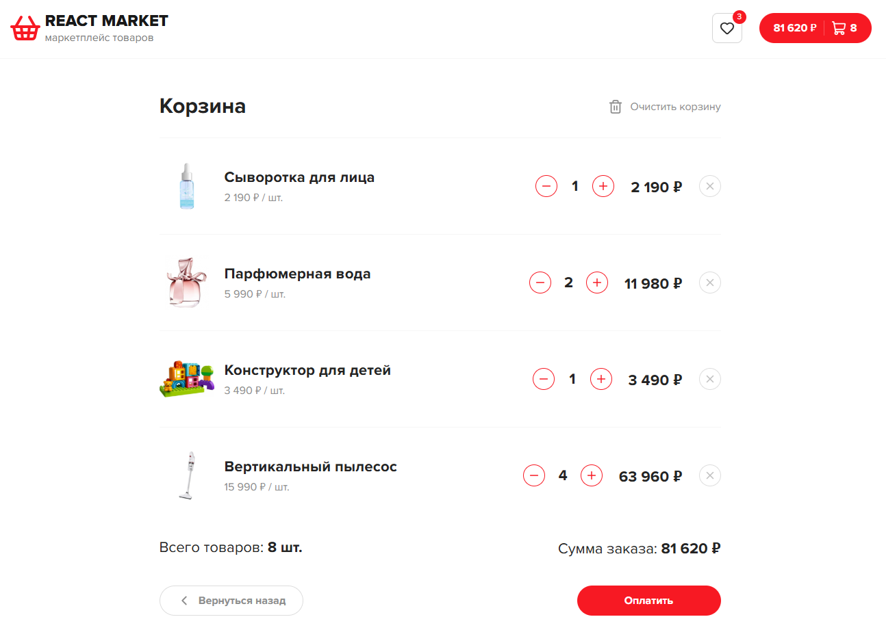

# React Market

Веб-приложение интернет-магазина. Позволяет просматривать каталог и подробную информацию о товарах, искать, фильтровать и сортировать товары, добавлять их в корзину и избранное, а также оформлять заказы.

[Открыть демо](https://katrinhurricanegsl.github.io/react-market/)

## Возможности

- Каталог товаров с пагинацией;
- Поиск, сортировка и фильтрация по категориям;
- Сохранение параметров каталога в URL;
- Просмотр подробной информации о товаре в модальном окне с галереей изображений;
- Добавление товаров в корзину и управление их количеством;
- Автоматический расчет стоимости корзины;
- Добавление товаров в избранное;
- Сохранение корзины и избранного в localStorage;
- Оформление заказа без реальной оплаты.

## Технологии

- React, TypeScript, Vite;
- Redux Toolkit;
- React Router;
- Axios;
- CSS Modules;
- Swiper;
- Lucide React;
- Lodash Debounce;
- ESLint.

## Скриншоты

### Каталог товаров

<p align="center">
  
</p>

### Корзина

<p align="center">
  
</p>

## Запуск

Установите зависимости:

```bash
npm install
```

Запустите API на базе `json-server`:

```bash
npm run server
```

В отдельном терминале запустите приложение:

```bash
npm run dev
```

После запуска откройте адрес, указанный Vite в терминале.
